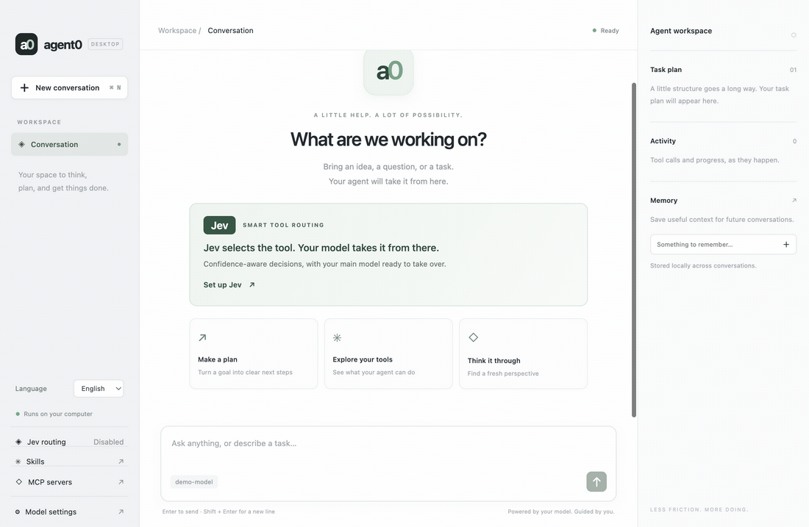

# agent0

**English** | [简体中文](README.zh-CN.md)

A desktop AI agent with **Jev-powered tool routing**, MCP integration, task planning, and persistent memory.

**Jev selects the tool. Your model handles the reasoning.** Enable optional TypeSafe Jev routing to select relevant tools with confidence-based fallback to your main model. Follow each decision, confidence score, and latency in the Activity panel.

[Set up Jev](docs/configuration.md#jev-routing) · [Download desktop builds](https://github.com/xudafeng/agent0/actions/workflows/build-electron.yml)



## Download the desktop app

[**Download Electron builds from GitHub Actions**](https://github.com/xudafeng/agent0/actions/workflows/build-electron.yml?query=branch%3Amain)

Prebuilt downloads include Electron; you do not need Node.js or pnpm to run the app.

1. Sign in to GitHub with an account that has read access to this repository.
2. Open the download link above and choose the latest successful **Build Electron app** run on `main`.
3. Scroll to **Artifacts** and download the build for your computer:

| Your computer | Artifact name | File inside |
| --- | --- | --- |
| macOS, Apple Silicon (M-series) | `agent0-mac-arm64-<commit>` | `agent0-<version>-mac-arm64.dmg` |
| macOS, Intel | `agent0-mac-x64-<commit>` | `agent0-<version>-mac-x64.dmg` |
| Windows, x64 | `agent0-win-x64-<commit>` | `agent0-<version>-win-x64.exe` |
| Linux, x64 | `agent0-linux-x64-<commit>` | `agent0-<version>-linux-x64.AppImage` |

`<commit>` identifies the source revision and `<version>` is the app version. On a Mac, **Apple menu → About This Mac** shows whether the computer uses an Apple chip or an Intel processor. Windows and Linux ARM builds are not currently provided.

### Install and launch

Extract the downloaded GitHub artifact ZIP first, then follow the steps for your platform:

- **macOS:** Open the DMG inside the artifact, drag `agent0.app` to **Applications**, and open it.
- **Windows:** Run the `.exe` installer and follow the installation prompts, then launch **agent0** from the Start menu.
- **Linux:** Give the `.AppImage` file execute permission in your file manager, then open it. Alternatively, run `chmod +x agent0-<version>-linux-x64.AppImage` and `./agent0-<version>-linux-x64.AppImage`, replacing `<version>` with the downloaded version.

macOS builds use ad-hoc signatures for bundle integrity, but are not Developer ID signed or notarized. Windows builds are unsigned. Your operating system may block the initial launch. On macOS, after attempting to open the app, use **System Settings → Privacy & Security → Open Anyway** if you trust this build. Ad-hoc signing does not bypass Gatekeeper.

On first launch, open **Model settings**, choose Kimi or OpenAI, and enter your model ID and API key. Jev routing is optional and uses a separate TypeSafe API key.

### If downloads are unavailable

Artifacts expire after **14 days**. If a run has no matching artifact, check that its platform build completed successfully and the artifact has not expired. Repository collaborators with permission to run workflows can start a fresh build using **Run workflow** on the [workflow page](https://github.com/xudafeng/agent0/actions/workflows/build-electron.yml), selecting `main`. Otherwise, use a newer successful run or [build from source](#run-from-source).

Downloads are currently distributed through Actions artifacts; this workflow does not publish installers to GitHub Releases. See [GitHub's artifact download guide](https://docs.github.com/en/actions/how-tos/manage-workflow-runs/download-workflow-artifacts) for access requirements.

## Run from source

```bash
pnpm install
pnpm start
```

The app opens a native desktop window. Choose **Model settings**, select Kimi or OpenAI, and enter your model ID and API key. Ask a question or describe a task to begin.

- Press Enter to send, or Shift + Enter for a new line.
- Watch tool activity and the agent's task plan in the workspace panel.
- Save useful context in Memory to reuse across conversations.
- Choose New conversation (Cmd/Ctrl + N) to clear the chat and plan while keeping memory.
- Switch between English and Simplified Chinese using Language in the sidebar or model settings. The interface initially follows your system language and remembers your choice locally. Conversation content stays in its original language.
- Open **MCP servers** in the sidebar to add local stdio or remote HTTP/SSE servers, test connections, inspect tools, and enable or disable integrations. See [MCP configuration](docs/configuration.md#mcp-servers) for setup details.
- Choose **Built-in Filesystem**, select a folder, and save to let the agent read, write, and organize files within that folder. The server is bundled with the app; no separate Node.js installation is required.
- Open **Jev routing** to enable TypeSafe's decision model with your own TypeSafe API key. Jev selects a relevant tool before each main-model step; Activity shows the decision, confidence, and latency. See [Jev configuration](docs/configuration.md#jev-routing).

Model responses appear when each agent run finishes; tool activity updates during the run. The current conversation survives a window reload and stays in memory until you start a new conversation or quit. Saved memory and model settings persist after quitting.

## Build a macOS app

```bash
pnpm package
```

Open `release/mac-arm64/agent0.app` on Apple Silicon (or `release/mac/agent0.app` on Intel). You can copy the app into Applications. This local build uses an ad-hoc signature and is not notarized for distribution.

The packaged app stores settings in `~/Library/Application Support/agent0/.env`, with memory and traces in its `data` directory. Development uses the project's `.env` and `data` directory. API keys are stored locally in plaintext and are never bundled into the app. Requests go to the configured model provider.

The application icon lives in `desktop/assets`. After editing `icon.svg`, run `pnpm build:icons` on macOS to regenerate the PNG and ICNS assets, then run `pnpm package` to rebuild the app.

## Record the Jev demo

The README GIF records the real desktop UI with simulated local model and Jev APIs; it does not use real API keys. On macOS, install `ffmpeg`, then run:

```bash
pnpm build
pnpm exec electron scripts/record-jev-demo.mjs
```

The recording uses an isolated temporary profile and writes `docs/images/agent0-jev-demo.gif`.

## GitHub Actions builds

The [**Build Electron app** workflow](.github/workflows/build-electron.yml) runs on branch pushes, `v*` tags, pull requests, and manual dispatch. It uses the pinned pnpm version and resolves dependencies from `package.json` with `pnpm install --no-frozen-lockfile`, then runs typechecking and unit tests before packaging. Lockfiles are ignored, so resolved dependency versions can change between builds.

See [Download the desktop app](#download-the-desktop-app) for artifact names and installation steps. Artifacts are retained for 14 days. No signing secrets or model API keys are needed in CI; users configure their own API keys in the app.

Both macOS builds mount the final DMG and verify the application signature. The Apple Silicon build also runs the desktop integration smoke test and launches the mounted app with an isolated temporary profile to check the packaged dependencies, preload, renderer, and skill discovery. Intel macOS is cross-packaged on the same Apple Silicon runner; Windows, Linux, and Intel application launch behavior still needs testing on those systems.

## Command line

```bash
cp .env.example .env
# Fill in your provider settings.
pnpm cli
```

| Command | Description |
| --- | --- |
| `/memory` | Show persistent memory. |
| `/remember <text>` | Save a memory. |
| `/task` | Show the current task plan. |
| `/skills` | List discovered local skills and loading errors. |
| `exit` | Quit. |

See [configuration](docs/configuration.md) for provider settings.

## Skills

The desktop and CLI runtimes discover local `SKILL.md` workflows from `~/.agents/skills` and `.agents/skills` in the configuration directory. Mention a skill as `$skill-name`, or describe a task matching its description. The model can load its instructions and supporting text files on demand. See [skill configuration](docs/configuration.md#skills) for installation, custom directories, and current limits.

## Development

```bash
pnpm typecheck
pnpm test
pnpm build
pnpm test:desktop
pnpm eval
```

The desktop smoke test uses an isolated temporary profile and a local mock model endpoint; it does not use your API keys. Evaluation calls your configured real model.

## Computer backend

Agent0 can bind each conversation to a persistent computer workspace.

Local computer:

```bash
AGENT0_COMPUTER=local
```

E2B cloud sandbox:

```bash
AGENT0_COMPUTER=e2b
E2B_API_KEY=your_e2b_api_key
```

When E2B is enabled, the first runtime use of a conversation creates a sandbox and immediately persists its `ComputerRef`. Switching away pauses the sandbox with memory preserved; reopening the conversation or restarting Agent0 reconnects to the same sandbox and workspace.

## Background runtime

Agent0 can persist one-shot, interval, and timezone-aware cron schedules in the current computer workspace and execute them as durable background jobs.

Run one wake cycle manually with:

```bash
pnpm wake
```

The wake runner:

- scans sessions with persisted computer bindings
- reconnects each computer
- reconciles running/unknown job state
- starts any schedules that are due
- reports the earliest `nextWakeAt`
- suspends pause/resume-capable computers before exiting

This command is intentionally one-shot. An operating-system service or cloud scheduler can invoke `pnpm wake` when needed without coupling Agent0's runtime to a specific platform scheduler.

## Persistent memory

Agent0 stores durable memory as readable Markdown under:

```
data/memory/
├── profile.md
├── preferences.md
├── projects.md
├── working.md
└── general.md
```

Memory entries have stable IDs and can be searched, updated, moved between scopes, or deleted. Existing `data/memory.md` bullet entries are migrated into `general.md` on first use.

Before each model turn, Agent0 retrieves memory relevant to the current prompt and injects only the selected entries into context. Memory, conversation, skills, task state, and computer context each have independent character budgets.

The desktop Memory panel supports scoped saves plus search, edit, and delete operations.

## Personal agent state

Agent0 keeps operational personal state separate from long-term memory.

```
data/personal/
├── state.json
└── daily/
    └── YYYY-MM-DD.md
```

The persistent state tracks:

- daily focus
- long-term goals
- active and completed tasks
- short daily working notes

Unlike retrieved memory, personal state is injected into every model turn so the agent can continue current work without requiring the user to restate active goals and tasks.

Agent tools can read and update personal state, while desktop-initiated mutations remain directly controllable from the **Today** panel. Model-initiated state changes require approval.

Daily journal entries are appended as readable Markdown and remain separate from the machine-oriented current state.

## Autonomous runtime

Agent0 can persist long-horizon missions separately from short per-conversation task plans.

A mission contains:

- a goal
- a dependency graph of durable tasks
- task results
- attached artifacts
- an optional human handoff
- an evaluator score and summary

Mission state is stored under `data/autonomy`; generated artifacts live under `data/artifacts`.

### Parallel delegation

`autonomy_delegate_parallel` can execute up to four dependency-ready mission tasks in isolated subagents concurrently. Subagent inference runs in parallel, while durable mission updates are committed sequentially to prevent lost writes.

### Human handoff

When the agent cannot safely or correctly continue without user judgment, `autonomy_request_handoff` explicitly blocks the mission. The desktop Mission panel surfaces the question and lets the user respond before work resumes.

### Evaluation

`autonomy_evaluate` uses an isolated evaluator turn with explicit criteria and persists a 0–1 score plus summary on the mission.

### Artifacts

Agents can create durable Markdown, text, or JSON artifacts, attach them to a mission, and reopen them from the desktop Mission panel.

## Web research with Exa

Agent0 can expose native web primitives backed by Exa when `EXA_API_KEY` is configured.

```bash
EXA_API_KEY="..."
```

The desktop Model settings dialog can save the Exa key locally as well. Saved keys are not returned to the renderer; the UI only receives whether Exa is configured.

### Tools

`web_search` discovers ranked web sources and returns query-relevant highlights. It supports:

- `auto`, `fast`, and `instant` search modes
- domain allow/block filters
- publication date range filters
- content freshness through `maxAgeHours`
- bounded result and highlight sizes

`web_fetch` retrieves clean content for one known URL:

- `highlights` is the default and recommended mode for agent context
- `text` returns broader clean page content when document structure or full context is required
- HTTP(S) URLs with embedded credentials are rejected
- returned content is capped before it enters the agent loop

Both tools are idempotent, propagate cancellation, use a 30-second tool timeout, and retry transient Exa/network failures up to three times.

The intended research flow is:

```
web_search
    ↓
rank and inspect highlights
    ↓
web_fetch on selected URLs
    ↓
browser/MCP fallback only when retrieval is insufficient
```

Agent0 intentionally does not expose Exa Deep Search or Agent API in this layer. Planning, decomposition, evaluation, and research orchestration remain responsibilities of Agent0's own runtime.

## Headless agent runs

Agent0 can execute a complete Agent workflow without Electron.

```bash
pnpm agent-run -- \
  --cwd /path/to/project \
  --skill radar \
  --policy trusted-workspace \
  --prompt "Run the radar workflow."
```

When `--skill` is used with `--cwd` and no explicit `--skill-dir`, Agent0 treats the working directory itself as a standalone skill root and loads its repository-level `SKILL.md`.

You can also specify standalone skill roots explicitly:

```bash
pnpm agent-run -- \
  --cwd /path/to/project \
  --skill-dir /path/to/project \
  --skill radar \
  --prompt "Run radar."
```

### Profile and working directory

Headless execution separates Agent0 state from the project being operated on:

```
Agent0 profile
└── data/
    ├── agent-runs/
    ├── headless-sessions/
    ├── runs/
    ├── executions/
    ├── memory/
    ├── personal/
    ├── autonomy/
    ├── artifacts/
    └── traces.ndjson

External working directory
└── project files operated on by computer_* tools
```

The external directory is used directly rather than copied into Agent0. Passing `--cwd` does not change the process-wide working directory, so Agent0 state does not leak into the target repository.

### Non-interactive policies

Headless runs cannot stop and wait for a desktop approval dialog.

- `read-only` is the default. It allows research, retrieval, skill loading, and other read-only operations while blocking persistent mutations and computer execution/write tools.
- `trusted-workspace` allows non-interactive mutations and command execution. Use it only for a working directory and skill instructions you trust.

MCP tools are disabled in headless mode by default because their side effects are not visible to the local policy boundary.

### Durable AgentRun records

Each invocation creates a durable `AgentRun` record with:

- prompt
- trigger
- policy
- session
- working directory
- skill
- runtime run ID
- status
- result or error

Inspect recent runs with:

```bash
pnpm agent-run -- --list
pnpm agent-run -- --status <agentRunId>
```

Recent AgentRuns are also visible in the desktop Background inspector.

### Session continuity

Pass a prior headless session ID to continue conversation/runtime state:

```bash
pnpm agent-run -- \
  --session <sessionId> \
  --prompt "Continue the work."
```

Headless sessions are stored separately from desktop conversations so background activity does not change the desktop's active chat.

### Crash recovery

A hard process crash leaves the AgentRun in `running` state and preserves the runtime checkpoint ID captured at `run_start`.

Resume it with:

```bash
pnpm agent-run -- --resume-agent-run <agentRunId>
```

The run resumes from the last durable runtime checkpoint instead of restarting the original prompt.

## Scheduled Agent automations

Agent0 can schedule complete headless Agent workflows, not only shell commands.

A scheduled Agent automation persists:

- prompt
- trusted working directory
- skill and standalone skill roots
- non-interactive policy
- interval or cron recurrence
- next run time
- last/running AgentRun
- run count
- last error

### Run radar every 12 hours

After configuring the same Agent0 profile with model credentials and `EXA_API_KEY`, create the automation:

```bash
pnpm agent-automation -- create \
  --name radar \
  --cwd /path/to/xdf-radar-skills \
  --skill radar \
  --every 12h \
  --policy trusted-workspace \
  --prompt "用 radar 做一版今天的 AI 行业趋势扫描"
```

Because the skill name and working directory are provided together, the radar repository itself is used as the standalone skill root.

Inspect or control the automation:

```bash
pnpm agent-automation -- list
pnpm agent-automation -- status <automationId>
pnpm agent-automation -- cancel <automationId>
pnpm agent-automation -- enable <automationId>
```

Cron schedules are also supported:

```bash
pnpm agent-automation -- create \
  --name radar \
  --cwd /path/to/xdf-radar-skills \
  --skill radar \
  --cron "0 */12 * * *" \
  --timezone Asia/Shanghai \
  --policy trusted-workspace \
  --prompt "用 radar 做一版今天的 AI 行业趋势扫描"
```

### Worker

Run a long-lived worker:

```bash
pnpm agent-worker
```

The worker executes both:

- profile-level scheduled Agent automations
- existing session-bound durable shell schedules

It wakes at least once per minute so newly created earlier schedules are discovered, while using the persisted `nextRunAt` values for actual due checks.

For an always-on Mac mini, run this process under a supervisor such as `launchd` or another process manager. The supervisor keeps the worker alive across process exits or machine restarts; recurrence semantics remain owned by Agent0.

Use the same `AGENT0_PROFILE_DIR` for the desktop app, CLI, worker, and one-shot wake command when the profile is not the repository root.

A one-shot wake remains available:

```bash
pnpm wake
```

### Catch-up and overlap semantics

Scheduled Agent automations use **catch up once** semantics.

If the machine sleeps through several intervals, the next wake launches at most one missed AgentRun. The next recurrence is then calculated from the wake time rather than replaying every missed interval.

Before a run starts, Agent0:

1. acquires an exclusive per-automation claim file;
2. checks whether a prior `runningAgentRunId` is still running;
3. advances `nextRunAt`;
4. creates a scheduled Headless AgentRun.

This prevents two normal workers from starting the same automation concurrently.

A hard process crash can intentionally leave a claim/running marker behind rather than risking duplicate side effects. Automated stale-run recovery belongs to the later automation-hardening layer.

### Security boundary

`trusted-workspace` allows the scheduled AgentRun to execute commands and write inside the configured working directory.

It does **not** allow a headless Agent to create, cancel, or enable Agent automations. Schedule mutation always requires an explicit CLI action or an interactive desktop approval.

MCP tools remain disabled in non-interactive headless runs.

## Automation hardening

Long-running Agent automations include additional production safeguards.

### Stale lock recovery

Per-automation claim files record the owning process ID.

If a worker exits unexpectedly and leaves a lock behind, the next worker checks whether the owner process still exists:

- live PID → keep the claim and skip duplicate execution
- dead PID → remove the stale lock and reclaim the automation
- malformed lock → fail that automation wake without deleting unknown state

A failure in one automation claim does not stop other automations from being evaluated.

### Stale AgentRun recovery

Headless AgentRun records track the owner PID and a heartbeat timestamp.

When a worker restarts and finds a `runningAgentRunId`:

- live owner process → skip; the run is still active
- unknown legacy ownership → skip conservatively
- dead owner + runtime checkpoint → resume the same AgentRun
- dead owner without runtime checkpoint → mark that run failed; do not pretend it completed

Resuming the existing checkpoint is preferred over starting a new AgentRun so non-idempotent radar delivery steps are not replayed blindly.

### Run timeout

Scheduled AgentRuns default to a six-hour maximum duration.

Override it when creating an automation:

```bash
pnpm agent-automation -- create \
  --name radar \
  --cwd /path/to/xdf-radar-skills \
  --skill radar \
  --every 12h \
  --timeout 4h \
  --policy trusted-workspace \
  --prompt "用 radar 做一版今天的 AI 行业趋势扫描"
```

The Agent tool also accepts `maxRunMs`.

Timeout cancellation flows through the normal AbortSignal path, so the Headless AgentRun is persisted as cancelled/failed rather than remaining stuck in `running`.

### Failure backoff

Automations track consecutive failures.

After a failure, Agent0 applies exponential cooldown:

```
5m → 10m → 20m → 40m → ... → max 6h
```

The cooldown never shortens the normal recurrence. A 12-hour radar automation therefore still waits for its normal next interval unless that interval would otherwise arrive sooner than the cooldown.

A successful run resets the failure streak. Explicitly re-enabling an automation also clears its failure streak and backoff.

### Setup failures

Failures before model execution—such as:

- missing working directory
- invalid skill root
- missing provider credentials
- runtime initialization errors

are now part of the durable Headless AgentRun lifecycle. Once an AgentRun record exists, setup failures are persisted as failed/cancelled instead of leaving a false `running` record.

